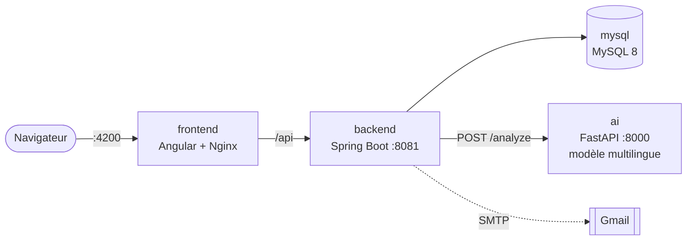

# EniForum

**Plateforme d'organisation du Forum Entreprises de l'ENICarthage**, avec un module d'intelligence
artificielle qui analyse, classe et compare les CV des candidats aux comités.


---

## Sommaire
1. [Fonctionnalités](#fonctionnalités)
2. [Architecture](#architecture)
3. [Lancer EniForum en une commande](#-lancer-eniforum-en-une-commande)
4. [Cloner et construire les images soi-même](#-cloner-et-construire-les-images-soi-même)
5. [Lancer avec `docker run` (sans Compose)](#-lancer-avec-docker-run-sans-compose)
6. [Variables d'environnement et ports](#-variables-denvironnement-et-ports)
7. [Publier sur Docker Hub](#-publier-sur-docker-hub)
8. [Développement sans Docker](#-développement-sans-docker)
9. [Module IA de matching des CV](#-module-ia-de-matching-des-cv)
10. [Structure du dépôt](#-structure-du-dépôt)

---

## Fonctionnalités

| Rôle | Ce qu'il peut faire |
|---|---|
| **Administrateur** | Créer le projet Forum, gérer les utilisateurs, superviser l'avancement global |
| **Comité de pilotage** | Valider les candidatures, utiliser le module IA, suivre les comités |
| **Coordinatrice** | Suivre les tâches, le planning et les workshops |
| **Chef de comité** | Gérer les membres et les tâches de son comité |
| **Membre** | Consulter et mettre à jour ses tâches, recevoir les notifications |
| **Candidat (public)** | Déposer son CV pour devenir membre ou chef de comité |

**Module IA :** score de pertinence sur 100 pour chaque CV, recommandation (*à prioriser*,
*entretien*, *moins adapté*), points forts, compétences manquantes et tableau comparatif des candidats.

---

## Architecture



| Image Docker Hub | Contenu | Taille approx. |
|---|---|---|
| `fatmabouajla/eniforum-frontend` | Angular compilé, servi par Nginx (non-root) | ~50 Mo |
| `fatmabouajla/eniforum-backend` | API Spring Boot, JRE 17 Alpine (non-root) | ~200 Mo |
| `fatmabouajla/eniforum-ai` | Service IA + modèle sémantique inclus (fonctionne hors ligne) | ~1,5 Go |
| `mysql:8.0` | Image officielle | — |

Les images sont publiées pour **linux/amd64** et **linux/arm64** (PC Intel/AMD et Mac Apple Silicon).

---

## 🚀 Lancer EniForum en une commande

**Prérequis :** [Docker Desktop](https://www.docker.com/products/docker-desktop/) (Windows, macOS) ou Docker Engine + Compose (Linux), démarré.

### 1. Récupérer le fichier de lancement

```bash
mkdir eniforum && cd eniforum
curl -fsSLO https://raw.githubusercontent.com/fatmaBouajla/eniforum/main/docker-compose.yml
```

> Windows PowerShell : remplacez `curl` par `curl.exe`.

### 2. Démarrer

```bash
docker compose up -d
```

Docker télécharge les images (≈ 2 Go la première fois), crée la base de données, le compte administrateur, l'édition du Forum, les 6 comités
et quelques données de démonstration.
Comptez 1 à 2 minutes avant que tout soit prêt (`docker compose ps` doit afficher `healthy`).

### 3. Se connecter

| | |
|---|---|
| Application | **http://localhost:4200** |
| Email | `admin@eniforum.tn` |
| Mot de passe | `Admin@2026` |
| Documentation de l'API IA | http://localhost:8000/docs |

**Comptes de démonstration** (mot de passe `Demo@2026`) — désactivables avec `DEMO_DATA=false` :

| Rôle | Email |
|---|---|
| Comité de pilotage | `pilotage@eniforum.tn` |
| Coordinatrice | `coordinatrice@eniforum.tn` |
| Chef du comité Design | `chef.design@eniforum.tn` |
| Chef du comité Sponsoring | `chef.sponsoring@eniforum.tn` |
| Membre (Design) | `membre@eniforum.tn` |
| Membre (Sponsoring) | `membre2@eniforum.tn` |

Six candidatures avec de vrais CV PDF sont aussi déposées et analysées par l'IA au démarrage.

> ⚠️ Changez ces identifiants pour toute utilisation réelle (voir [variables](#-variables-denvironnement-et-ports)).

### Commandes utiles

```bash
docker compose ps            # état des services
docker compose logs -f       # journaux en direct (Ctrl+C pour quitter)
docker compose pull          # récupérer la dernière version des images
docker compose down          # arrêter (les données sont conservées)
docker compose down -v       # arrêter ET supprimer les données (base + CV)
```

### Personnaliser (facultatif)

Créez un fichier `.env` à côté de `docker-compose.yml` :

```bash
curl -fsSL https://raw.githubusercontent.com/fatmaBouajla/eniforum/main/.env.example -o .env
```

Modifiez-le (mot de passe admin, clé JWT, email…), puis relancez `docker compose up -d`.

---

## 🛠 Cloner et construire les images soi-même

```bash
git clone https://github.com/fatmaBouajla/eniforum.git
cd eniforum
cp .env.example .env          # facultatif

# Construire les 3 images à partir du code et tout démarrer
docker compose -f docker-compose.yml -f docker-compose.build.yml up -d --build
```

> Connexion lente ? Construisez les images une par une (moins de téléchargements simultanés) :
> `docker compose -f docker-compose.yml -f docker-compose.build.yml build backend`, puis `frontend`, puis `ai`,
> et enfin `docker compose up -d`. Si un téléchargement est coupé (erreur *hash mismatch* de pip),
> relancez simplement la commande : les fichiers déjà téléchargés sont réutilisés.

Construire une seule image :

```bash
docker build -t eniforum-backend  ./backend
docker build -t eniforum-frontend ./frontend
docker build -t eniforum-ai       ./ai-service      # ~10 min la première fois (PyTorch + modèle)
```

---

## 🐳 Lancer avec `docker run` (sans Compose)

Utile pour comprendre ce que fait Compose, ou pour lancer un seul service. Les conteneurs doivent
partager un **réseau Docker** pour se trouver par leur nom.

```bash
# 0. Réseau et volumes
docker network create eniforum
docker volume create eniforum-mysql
docker volume create eniforum-cv

# 1. Base de données
docker run -d --name mysql --network eniforum \
  -e MYSQL_DATABASE=forum_enicarthage \
  -e MYSQL_ROOT_PASSWORD=eniforum \
  -v eniforum-mysql:/var/lib/mysql \
  mysql:8.0

# 2. Service IA
docker run -d --name ai --network eniforum \
  -p 8000:8000 \
  fatmabouajla/eniforum-ai:latest

# 3. Backend (attendre ~20 s que MySQL soit prêt)
docker run -d --name backend --network eniforum \
  -p 8081:8081 \
  -e DB_URL="jdbc:mysql://mysql:3306/forum_enicarthage?createDatabaseIfNotExist=true&useSSL=false&serverTimezone=UTC&allowPublicKeyRetrieval=true" \
  -e DB_USERNAME=root \
  -e DB_PASSWORD=eniforum \
  -e CV_AI_BASE_URL=http://ai:8000 \
  -e JWT_SECRET="$(openssl rand -base64 48)" \
  -e ADMIN_PASSWORD=Admin@2026 \
  -v eniforum-cv:/app/uploads \
  fatmabouajla/eniforum-backend:latest

# 4. Frontend
docker run -d --name frontend --network eniforum \
  -p 4200:8080 \
  -e BACKEND_URL=http://backend:8081 \
  fatmabouajla/eniforum-frontend:latest
```

Le backend crée lui-même le compte administrateur (`ADMIN_EMAIL` / `ADMIN_PASSWORD`) au démarrage.

Ouvrez http://localhost:4200. Pour tout arrêter :
`docker rm -f frontend backend ai mysql && docker network rm eniforum`.

> Sous Windows PowerShell, remplacez les `\` de fin de ligne par des accents graves `` ` ``,
> et `$(openssl rand -base64 48)` par une chaîne aléatoire d'au moins 44 caractères.

---

## ⚙ Variables d'environnement et ports

### Fichier `.env` (utilisé par `docker-compose.yml`)

| Variable | Défaut | Rôle |
|---|---|---|
| `DOCKERHUB_USER` | `fatmabouajla` | Compte Docker Hub d'où viennent les images |
| `ENIFORUM_TAG` | `latest` | Version des images (`latest`, `1.0.0`…) |
| `APP_PORT` / `API_PORT` / `AI_PORT` | `4200` / `8081` / `8000` | Ports ouverts sur votre machine |
| `DB_PASSWORD` | `eniforum` | Mot de passe root MySQL |
| `JWT_SECRET` | clé de démo | Clé de signature des sessions (`openssl rand -base64 48`) — **à changer** |
| `ADMIN_NAME` / `ADMIN_EMAIL` / `ADMIN_PASSWORD` | `Administrateur` / `admin@eniforum.tn` / `Admin@2026` | Compte admin créé (ou promu) au démarrage |
| `DEMO_DATA` | `true` | Comptes, tâches, workshops et candidatures de démonstration |
| `MAIL_USERNAME` / `MAIL_PASSWORD` | *(vide)* | Gmail + [mot de passe d'application](https://myaccount.google.com/apppasswords) ; vide = emails désactivés |
| `FRONTEND_URL` | `http://localhost:4200` | Adresse utilisée dans les liens des emails |

### Variables de chaque image

| Image | Variable | Défaut |
|---|---|---|
| backend | `DB_URL`, `DB_USERNAME`, `DB_PASSWORD` | MySQL local, `root`, vide |
| backend | `CV_AI_BASE_URL` | `http://ai:8000` |
| backend | `JWT_SECRET`, `MAIL_USERNAME`, `MAIL_PASSWORD`, `FRONTEND_URL` | voir ci-dessus |
| backend | `ADMIN_EMAIL`, `ADMIN_PASSWORD`, `ADMIN_NAME`, `DEMO_DATA` | `admin@eniforum.tn`, `Admin@2026`, `Administrateur`, `false` |
| backend | `JAVA_OPTS` | `-XX:MaxRAMPercentage=75 -XX:+ExitOnOutOfMemoryError` |
| frontend | `BACKEND_URL` | `http://backend:8081` |
| ai | `CV_AI_DISABLE_EMBEDDINGS` | *(vide)* ; `1` = mode léger TF-IDF |

### Ports internes des conteneurs

| Service | Port | Volume persistant |
|---|---|---|
| frontend | `8080` | — |
| backend | `8081` | `/app/uploads` (CV déposés) |
| ai | `8000` | — |
| mysql | `3306` (non exposé) | `/var/lib/mysql` |

---

## 📦 Publier sur Docker Hub

### Automatiquement (GitHub Actions) — recommandé

Le workflow [`.github/workflows/docker-publish.yml`](.github/workflows/docker-publish.yml) lance
les tests de l'IA puis construit et publie les 3 images (amd64 + arm64).

**Configuration, une seule fois :**
1. Docker Hub → *Account settings* → *Personal access tokens* → créer un jeton (*Read & Write*).
2. GitHub → dépôt → *Settings* → *Secrets and variables* → *Actions* → ajouter :
   - `DOCKERHUB_USERNAME` : votre identifiant Docker Hub
   - `DOCKERHUB_TOKEN` : le jeton créé à l'étape 1

**Ensuite :**
- chaque `git push` sur `main` publie les images avec le tag `latest` ;
- une version stable se publie avec un tag git :
  ```bash
  git tag v1.0.0 && git push origin v1.0.0     # -> images 1.0.0, 1.0 et latest
  ```

### Manuellement

```bash
docker login
export DOCKERHUB_USER=votre-identifiant       # PowerShell : $env:DOCKERHUB_USER="votre-identifiant"
docker compose -f docker-compose.yml -f docker-compose.build.yml build
docker compose -f docker-compose.yml -f docker-compose.build.yml push
```

> Si votre identifiant Docker Hub n'est pas `fatmabouajla`, remplacez-le dans ce README et
> dans la valeur par défaut de `DOCKERHUB_USER` de `docker-compose.yml`.

---

## 💻 Développement sans Docker

Prérequis : Java 17, Maven, Node 20, Python 3.11, MySQL 8.

```bash
# Service IA
cd ai-service
python -m venv .venv && source .venv/bin/activate      # Windows : .venv\Scripts\activate
pip install -r requirements.txt
python download_model.py                               # une seule fois (~470 Mo)
uvicorn main:app --port 8000

# Backend (dans un autre terminal)
cd backend
cp secrets.example.properties secrets.properties       # puis remplissez-le
mvn spring-boot:run

# Frontend (dans un autre terminal)
cd frontend
npm install
npm start                                              # http://localhost:4200
```

**Sans MySQL** : `mvn spring-boot:run -Dspring-boot.run.profiles=h2` démarre le backend sur une base
en mémoire, avec les données de démonstration.

### Tests

```bash
# depuis la racine du dépôt
(cd backend && mvn test)                        # tests unitaires du backend
(cd ai-service && python -m pytest tests -q)    # tests du service IA
(cd ai-service && python tests/evaluer.py)      # évaluation du matching sur 10 CV de référence
python tests/smoke_api.py                       # parcours complet de l'API (backend lancé avec la démo)
```

Le rapport d'évaluation de l'IA est dans [`ai-service/tests/donnees/rapport_evaluation.md`](ai-service/tests/donnees/rapport_evaluation.md).
Les journaux du backend sont écrits dans la console et dans `logs/forum.log`.

---

## 🤖 Module IA de matching des CV

À chaque dépôt de CV, le backend envoie le PDF au service IA, qui le compare à la **fiche du poste**
visé (rôle × comité, définies dans [`ai-service/data/postes.json`](ai-service/data/postes.json)) :

1. extraction du texte et contrôle que le document est bien un CV ;
2. détection de ~90 compétences et de leurs synonymes FR/EN ;
3. similarité **sémantique** entre le CV et chaque attente du poste (modèle multilingue local) ;
4. repérage de l'expérience associative, des responsabilités et des stages ;
5. score sur 100 pondéré selon le rôle, recommandation et justification détaillée.

| Dimension | Membre | Chef de comité | Coordinatrice |
|---|---|---|---|
| Compétences clés | 40 | 35 | 30 |
| Adéquation du profil (sémantique) | 25 | 20 | 20 |
| Expérience & responsabilités | 15 | 25 | 30 |
| Formation & langues | 5 | 10 | 10 |
| Motivation | 15 | 10 | 10 |

Détails : [`ai-service/README.md`](ai-service/README.md) · Cahier des charges : [`docs/cahier-des-charges.pdf`](docs/cahier-des-charges.pdf)

---

## 📁 Structure du dépôt

```
eniforum/
├── backend/                  API Spring Boot (Java 17)
├── frontend/                 Application Angular 17 + configuration Nginx
├── ai-service/               Service IA (FastAPI, sentence-transformers)
├── docs/                     Cahier des charges, diagrammes
├── docker-compose.yml        Lancement en une commande (images Docker Hub)
├── docker-compose.build.yml  Construction des images depuis le code
├── .env.example              Modèle de configuration
└── .github/workflows/        Publication automatique sur Docker Hub
```

## 🔒 Sécurité
- Les conteneurs applicatifs tournent avec un utilisateur **non-root**.
- Aucun secret n'est inclus dans les images : tout passe par des variables d'environnement.
- Ne versionnez jamais `.env`, `secrets.properties` ni le dossier `uploads/` (données personnelles).
- Mots de passe hachés (BCrypt), jamais renvoyés par l'API ; sessions par jeton JWT.
- L'inscription publique crée toujours un compte **membre** : les autres rôles sont attribués par
  l'administrateur ou par l'acceptation d'une candidature.
- Chaque rôle ne voit que son périmètre (un chef de comité ne gère que son propre comité).
- Les CV déposés sont contrôlés (PDF réel, taille limitée) et leur nom de fichier est nettoyé.

## 👩‍💻 Auteurs
Projet réalisé à l'ENICarthage par Fatma Bouajla, Mayssa Abdouli et Rawen Zgarni.
